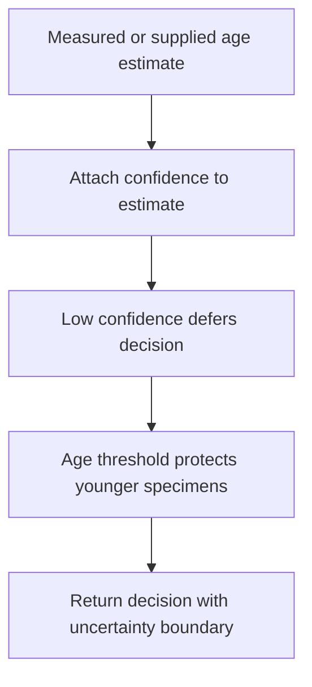
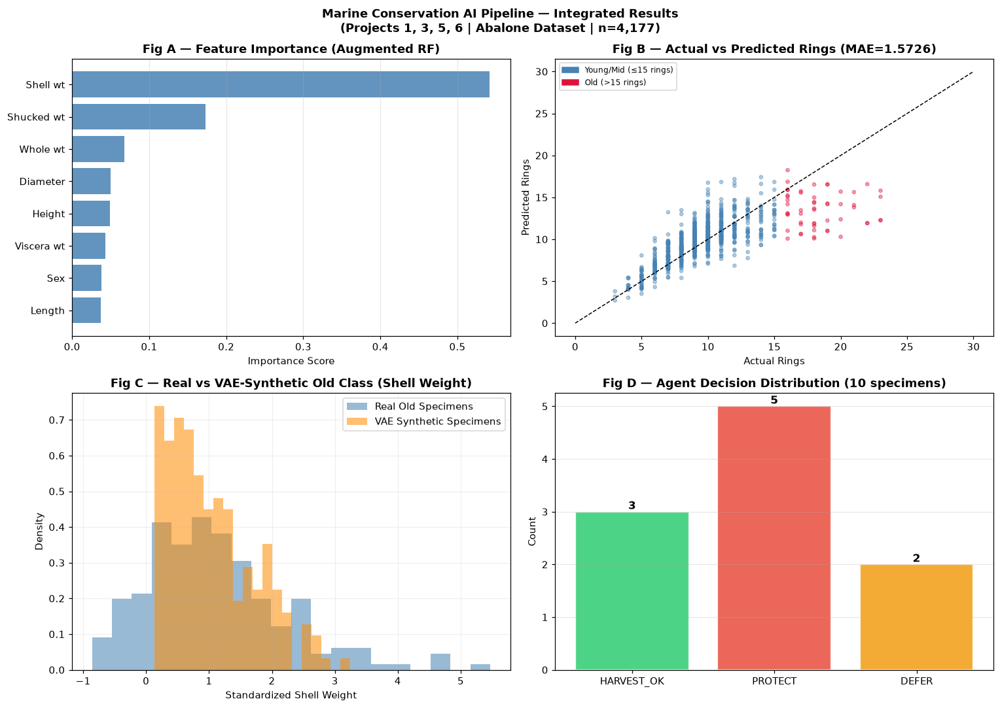

# Marine AI Decision Pipeline

Integrate tabular prediction, targeted generative augmentation, and traceable decision rules in a single abalone analysis pipeline.

## Implementation

A random-forest ring-count predictor, a VAE trained on older training specimens, synthetic augmentation, explicit defer/protect/allow rules, and an in-memory decision trace.



## Try a small example

Supplied age and confidence values exercise the notebook decision rule. The example does not run an age estimator or establish a fisheries policy.

After the local setup below, run from the repository root:

```sh
python examples/quickstart.py
```

The [example source](examples/quickstart.py), [captured output](examples/expected-output.txt) and [execution record](examples/environment.json) keep this demonstration inspectable. Floating-point values may vary with library versions.

Observed output from this run:

```text
{
  "fixture": "supplied hypothetical predictions, not RF outputs or valid harvest policy",
  "decisions": [
    "HARVEST_OK: Predicted 12.0 rings \u2265 minimum 11. Approved.",
    "DEFER: Confidence 0.70 below threshold 0.8. Recommend physical re-measurement.",
    "PROTECT: Predicted 8.0 rings < minimum 11. Do not harvest."
  ]
}
```

## Evidence and results

The release contains an executable experiment comparing the baseline and augmented models. Its preprocessing and augmentation now use training records only; corrected results are recorded after execution rather than copying earlier leakage-affected scores.

See [VALIDATION.md](VALIDATION.md) for the release checks and their scope.

## Fresh reproduction — October 17, 2026

After removing train/test leakage, the baseline overall MAE is 1.5615 rings and augmented MAE is 1.5726. Old-class MAE changes from 5.1377 to 4.9848. Augmentation improves the older subgroup by about 3.0% while slightly worsening overall MAE; the result is a trade-off rather than an overall win.

The environment versions, input hashes, and notebook hash are recorded in [results/reproduction.json](results/reproduction.json).



## Run locally

```sh
python -m venv .venv
source .venv/bin/activate
python -m pip install -r requirements.txt
jupyter lab analysis.ipynb
```

Prepare the inputs described in [DATA.md](DATA.md) first. Source validation is available without installing model dependencies:

```sh
python scripts/validate_source.py
```

## Limitations

Synthetic labels are sampled heuristically and may not match generated features. Tree disagreement is a heuristic score, not calibrated confidence. Decision thresholds illustrate a workflow and do not constitute a validated fisheries policy.
