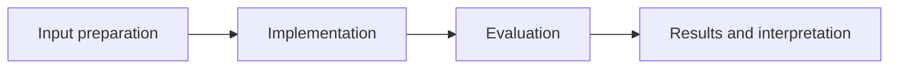

# Marine AI Decision Pipeline

**Feras Elghandour** · Technical case study

Integrate tabular prediction, targeted generative augmentation, and traceable decision rules in a single abalone analysis pipeline.

## Implementation

A random-forest ring-count predictor, a VAE trained on older training specimens, synthetic augmentation, explicit defer/protect/allow rules, and an in-memory decision trace.



## Evidence and results

The release contains an executable experiment comparing the baseline and augmented models. Its preprocessing and augmentation now use training records only; corrected results are recorded after execution rather than copying earlier leakage-affected scores.

Results described as saved come from the retained experiment record. See [VALIDATION.md](VALIDATION.md) for the checks performed on this release and their scope.

## Fresh reproduction — October 17, 2026

After removing train/test leakage, the baseline overall MAE is 1.5615 rings and augmented MAE is 1.5726. Old-class MAE changes from 5.1377 to 4.9848. Augmentation improves the older subgroup by about 3.0% while slightly worsening overall MAE; the result is a trade-off rather than an overall win.

The environment versions, input hashes, and notebook hash are recorded in [results/reproduction.json](results/reproduction.json).


## Practical relevance

This project demonstrates a random-forest ring-count predictor, a VAE trained on older training specimens, synthetic augmentation, explicit defer/protect/allow rules, and an in-memory decision trace.
The implementation and evaluation make the trade-offs inspectable for technical review.

## Run locally

```sh
python -m venv .venv
source .venv/bin/activate
python -m pip install -r requirements.txt
jupyter lab analysis.ipynb
```

Prepare the inputs described in [DATA.md](DATA.md) first. Source validation is available without installing model dependencies:

```sh
python scripts/validate_source.py
```

## Limitations

Synthetic labels are sampled heuristically and may not match generated features. Tree disagreement is a heuristic score, not calibrated confidence. Decision thresholds illustrate a workflow and do not constitute a validated fisheries policy.

## Development

Changes should include a clear description of the behavior affected and verification appropriate to that behavior. Keep input data, credentials, model caches, and generated artifacts outside version control.
